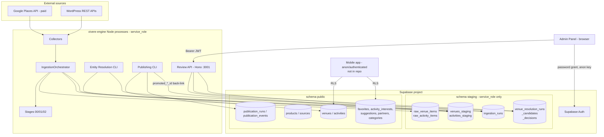
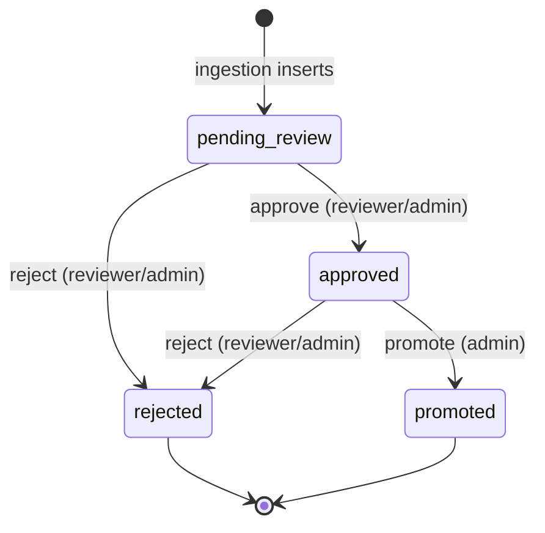
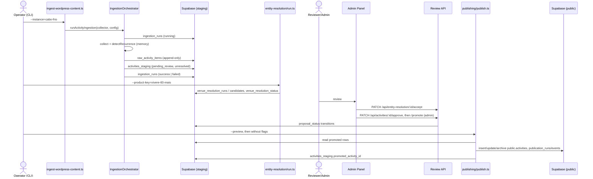

# 02 — System Architecture

> AS-IS sections describe what exists in the repository. FUTURE / PROPOSED sections are
> clearly labelled and **do not exist in code**.

---

## 1. Repository layout (AS-IS)

```
vivere-engine/
├── src/
│   ├── collectors/
│   │   ├── google-places/              # RawVenueItem producer (paid API)
│   │   ├── wordpress-content/          # RawActivityItem producer (generic WordPress)
│   │   └── prefeitura-agenda-cultural/ # older WordPress collector (Cabo Frio), shares source_key
│   ├── pipeline/stages/
│   │   ├── 00-filter-venue/            # Venue Filtering Engine (venues only)
│   │   ├── 01-geographic-gate/         # Regional Geographic Gate (venues only, ADR-0022)
│   │   └── 02-recurrence-detection/    # Recurrence detection (activities only)
│   ├── persistence/                    # Supabase client, repositories, IngestionOrchestrator
│   ├── entity-resolution/              # ER engine, matchers, CLI (run.ts, run-human-resolution.ts)
│   ├── publishing/                     # Publishing engine, CLI (publish.ts)
│   ├── review-api/                     # Hono HTTP API (server.ts) + CLI run-review-action.ts
│   ├── config/                         # pilotRegion.ts, sourcePriority.ts (partly unused)
│   ├── lib/                            # logger (pino), retry, budgetGuard, geo, resolveRegionFilter
│   └── types/                          # RawActivityItem.ts, RawVenueItem.ts
├── scripts/                            # ingest-*, dry-run-*, reprocess-*, security harness
├── db/migrations/                      # 0000–0022 (+ rollback files), applied manually
├── admin-panel/                        # React 18 + Vite 5 + TanStack Query + Tailwind
├── docs/                               # ADRs, architecture notes, runbooks, baselines, incidents
└── dry-run-snapshots/                  # JSON caches of Google Places dry runs (not source of truth)
```

## 2. Main components and responsibilities (AS-IS)

| Component | Responsibility | Must never | Key files |
|---|---|---|---|
| **Collectors** | Call one source technology, mechanically normalise (trim/encoding), return `RawVenueItem[]` / `RawActivityItem[]` + `errors[]` | Make business decisions, resolve venues, filter by relevance for the product (venue filter is a separate stage) | `src/collectors/*`, ADR-0001 |
| **IngestionOrchestrator** | Open `IngestionRun`, call collector, persist raw, run stages, persist staging, close run | Import concrete collectors (depends on `VenueCollectorContract` / `ActivityCollectorContract`) | `src/persistence/orchestration/IngestionOrchestrator.ts` |
| **Pipeline stages** | Pure, in-memory transformations: venue filter, geo gate, recurrence detection | Access the database | `src/pipeline/stages/*` |
| **Repositories (persistence)** | Translate contracts to rows, idempotent inserts (`upsert … ignoreDuplicates`) | Contain business logic | `src/persistence/repositories/*` |
| **Entity Resolution** | Generate candidates from reviewed venues, score (name/geo/address), classify, persist runs/candidates; record human decisions | Touch collectors; link to `pending_review` venues | `src/entity-resolution/*`, ADR-0011/0012/0013 |
| **Review API** | Authenticated HTTP access to staging for humans; state transitions; ER decisions | Write to `public.venues`/`public.activities` (promotion is staging-only) | `src/review-api/*`, ADR-0009 |
| **Admin Panel** | UI for review, ER queue, dashboard, ingestion runs | Recalculate engine results ("A UI nunca recalcula resultados do Engine", `04-pipeline.md`) | `admin-panel/src/*` |
| **Publishing Engine** | Read promoted staging rows, transform via whitelist, insert/update/archive in Layer C, write runs/events, back-link staging | Publish non-promoted data; write preserved app fields (`category`, `schedule`, `price`, `is_free`, `is_sponsored`, `interested_count`) | `src/publishing/*`, ADR-0018/0019/0020 |
| **Supabase (Postgres + Auth + PostgREST)** | Storage, RLS, Auth (JWT issuer for Admin Panel users) | — | `db/migrations/*` |

## 3. Boundaries (AS-IS)



Boundary rules confirmed by code/docs:

1. **Only service_role is intended to touch `staging.*`.** Engine and Review API both use
   `SUPABASE_SERVICE_KEY` (`src/persistence/client/supabase.ts`). Migration 0019 grants
   privileges to `service_role` only; ADR-0024 states staging is restricted to `service_role`.
   Note: the raw-table RLS policies (0002) are permissive to `PUBLIC`, so the protection against
   `anon`/`authenticated` relies on table grants and schema exposure — the live production grants are
   **To be confirmed** (see `09` SEC-G).
2. **The Admin Panel never talks to Postgres directly.** It only calls Supabase Auth
   (`/auth/v1/token?grant_type=password`) and the Review API (`admin-panel/src/api/client.ts`).
3. **Consumers read only Layer C** (ADR-0019 Invariant 2).
4. **The Publishing Engine is the only writer of engine data into Layer C** (ADR-0019
   Invariant 1; legacy rows and documented manual maintenance excepted).
5. **Promotion in the Review API is staging-only.** `markPromoted()` sets
   `proposal_status='promoted'`, `promoted_at`, and `promoted_*_id = null`
   (`ActivityReviewRepository`, `VenueReviewRepository`). The public row is created later by
   the Publishing CLI, which then fills `promoted_*_id`.

## 4. Collectors (AS-IS)

| Collector | Output | Source key(s) | Config | Paid? |
|---|---|---|---|---|
| `GooglePlacesCollector` | `RawVenueItem` | `google_places` | `src/collectors/google-places/config/vivere-60-mais.ts` (regions with `lat/lng/radius_m`, category queries), `targeted-venue-lookup.ts`, `targeted-er-lookup.ts` | Yes (Text Search; `StatsRepository` assumes USD 0.032/query, USD 10/month) |
| `WordPressContentCollector` | `RawActivityItem` | `prefeitura_cabo_frio`, `prefeitura_sao_pedro_da_aldeia` | `src/collectors/wordpress-content/config/registry.ts` (`AVAILABLE_INSTANCES`) | No |
| `PrefeituraAgendaCulturalCollector` | `RawActivityItem` | `prefeitura_cabo_frio` | `src/collectors/prefeitura-agenda-cultural/config.ts` | No |

Notes:
- `araruama.ts` exists but is **not registered** in `AVAILABLE_INSTANCES` and its `base_url` is
  marked `PLACEHOLDER` in a comment.
- `PrefeituraAgendaCulturalCollector` is referenced only by `scripts/dry-run-prefeitura-cabo-frio.ts`
  (no `ingest-*` script uses it). Real activity ingestion uses `WordPressContentCollector` via
  `scripts/ingest-wordpress-content.ts`. Whether the older collector is still needed is
  **To be confirmed**. Note that `src/pipeline/stages/02-recurrence-detection` imports
  `parseTimeRangePt` from this older collector's `sharedTextUtils.ts`, so the folder cannot simply be deleted.
- `src/config/sourcePriority.ts` lists `sesc`, `senac`, `sympla`, `eventbrite`, `facebook`,
  `instagram` — these are **configuration placeholders only**; no collectors exist for them and the
  file states the cross-source dedupe it describes is "ainda NÃO implementado".

## 5. Processing pipeline (AS-IS)

Venues:

```
Collector → raw_venue_items (always) → 00-filter-venue → 01-geographic-gate → venues_staging
                                                         (rejected by type is NOT staged)
```

Activities:

```
Collector (+ structured/narrative parsing) → 02-recurrence-detection (in memory)
          → raw_activity_items → activities_staging (pending_review, unresolved)
          → Entity Resolution → Human Review → Publishing
```

Details per stage: `04-ENGINE-PIPELINE.md`.

## 6. Supabase (AS-IS)

- Two schemas used by the engine: `staging` (Layers A and B, ER tables, ingestion runs) and
  `public` (Layer C, products/sources, publication runs/events, legacy app tables).
- Migrations are applied **manually** (SQL Editor); there is **no migration runner and no
  tracking table** (`db/migrations/README.md`).
- `0000_app_baseline.sql` is **bootstrap-only** and must never be applied to production.
- Reference data for `public.products` and `public.sources` is **not seeded by any migration or
  script** (runbook `staging-bootstrap.md` §6, "PENDENTE"). Since `ingestion_runs.source_key`
  and `*_staging.product_key` have FKs, a new source/product needs rows there first.
- The `staging` schema must be exposed in the Supabase Data API for PostgREST calls with
  `.schema('staging')` to work (runbook §4) — a project setting, not a migration.

## 7. Review API (AS-IS)

Hono app, `src/review-api/server.ts`, default port `3001` (`REVIEW_API_PORT`). JWT verified
against Supabase JWKS (ES256). Routes: `/health`, `/api/venues`, `/api/activities`,
`/api/ingestion-runs`, `/api/stats`, `/api/entity-resolution/*`. Full detail: `05-REVIEW-API-AND-ADMIN.md`.

## 8. Admin Panel (AS-IS)

React 18 + Vite 5 (`admin-panel/`), dev port `5173`. Pages: Dashboard, Venues, Venue detail,
Activities, Activity detail, Ingestion runs, Entity Resolution, Settings (placeholder "Em breve").
Product selector is hard-coded to `vivere-60-mais`.

## 9. Staging and publishing (AS-IS)



Publishing (`src/publishing/publish.ts --product-key=… [--dry-run|--preview]`):

- Venues eligible: `proposal_status='promoted'` and `geographic_status IS NULL OR <> 'outside_region'`.
  Venues with `proposal_status='rejected'` that were previously published are archived.
- Activities eligible: `proposal_status='promoted'` and
  `venue_resolution_status IN ('matched','proposed_new')`; `matched` additionally requires a human
  decision in `venue_resolution_decisions` (`skip_missing_human_decision` otherwise).
- Next future occurrence is published (ADR-0020); recurrence-only activities are publishable with
  `start_date = end_date = NULL` if the recurrence rule is valid.
- `engine_status` (`active`/`archived`/`draft`) — never delete, always archive (ADR-0016).

## 10. External integrations (AS-IS)

| Integration | Used by | Credential |
|---|---|---|
| Supabase PostgREST | Engine, Review API | `SUPABASE_URL`, `SUPABASE_SERVICE_KEY` |
| Supabase Auth (password grant) | Admin Panel | `VITE_SUPABASE_URL`, `VITE_SUPABASE_ANON_KEY` |
| Supabase Auth JWKS | Review API | derived from `SUPABASE_URL` |
| Google Places API (Text Search) | Google Places collector scripts | `GOOGLE_PLACES_API_KEY` |
| Public WordPress REST APIs of municipalities | WordPress collectors | none |

No LLM, OCR, social-media, image or video integration exists in the repository.

## 11. End-to-end flow (AS-IS)



---

## 12. FUTURE / PROPOSED — where the AI Discovery Layer fits

> **PROPOSED. Nothing in this section exists in the repository.**

```mermaid
flowchart LR
  S[Public sources:\nwebsites, social posts,\nimages, videos, PDFs] --> AID[AI Discovery Layer\nPROPOSED]
  AID -->|structured candidate\n= RawActivityItem + provenance| ORCH[Existing IngestionOrchestrator\nvia ActivityCollectorContract]
  ORCH --> RAW[(raw_activity_items)]
  ORCH --> STG[(activities_staging\npending_review)]
  STG --> ER[Entity Resolution]
  ER --> HR[Human Review]
  HR --> PUB[Publishing Engine]
  PUB --> OPS[(public.activities)]
  AID -.x.-> OPS
  AID -.x.-> STG
```

The dashed crossed arrows are **forbidden paths**: the AI Discovery Layer must not write to
`public.*` and must not write to `staging.*` tables directly (consistent with `06` §B.1). The recommended seam is the
existing `ActivityCollectorContract` (see `06-AI-DISCOVERY-INTEGRATION-CONTRACT.md`).

Other future items mentioned in ADRs (none implemented): scheduler (ADR-0014, Phase 9),
`public.venue_contributions` / `public.activity_source_links` (ADR-0006), public API and website
(ADR-0019), persistent budget tables `staging.api_usage_log` / `staging.api_budget_config`
(referenced in `src/lib/budgetGuard.ts`, not present in migrations).
