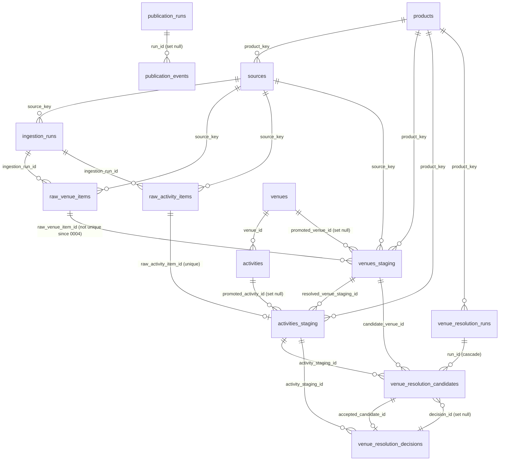

# 03 — Data Model Specification (DMS)

> Built **exclusively** from `db/migrations/0000`–`0022` and the repository code that reads/writes
> these tables. No field has been added that does not appear in a migration.
>
> ⚠ **Schema-as-code caveat.** Production was created partly by hand before the Engine existed
> (`0000` is a reconstruction, "BOOTSTRAP ONLY") and some objects were applied manually and only
> later captured (`0011`, `0020`, `0021`, `0022`). There is **no migration tracking table**. The live
> production schema may therefore differ from this document — **To be confirmed** against a fresh
> catalogue export before any schema-dependent work.

---

## 1. Schemas and layers

| Layer | Schema | Tables | Writer | Readers |
|---|---|---|---|---|
| Config | `public` | `products`, `sources` | Manual (no seed in repo) | Engine (FK targets) |
| A — Raw (append-only) | `staging` | `raw_venue_items`, `raw_activity_items` | Engine ingestion | Engine, Review API (via JOIN) |
| B — Staging / curation | `staging` | `venues_staging`, `activities_staging` | Engine ingestion, ER, Review API, Publishing (back-link) | Engine, Review API |
| ER | `staging` | `venue_resolution_runs`, `venue_resolution_candidates`, `venue_resolution_decisions` | ER CLI, Review API | Review API, Publishing |
| Ops audit | `staging` | `ingestion_runs` | Engine ingestion | Review API |
| C — Operational Model | `public` | `venues`, `activities` | Publishing Engine (engine rows); app/admin (legacy rows, `interested_count`) | Mobile app, consumers |
| Publishing audit | `public` | `publication_runs`, `publication_events` | Publishing Engine | — |
| App (legacy) | `public` | `favorites`, `activity_interests`, `suggestions`, `partners`, `categories`; views `users`, `active_activities` | Mobile app | Mobile app |

## 2. ER diagram (engine-relevant tables)

Not FK-enforced (by design or omission): `venues.product_key`/`activities.product_key` → `products`
(ADR-0015 "simplificação aceitável"), `publication_runs.product_key`, `publication_events.entity_id`,
`venues.engine_venue_id` → `venues_staging.id` (UNIQUE only), `activities.engine_activity_id` (UNIQUE only).

---

## 3. Tables — `public` config

### 3.1 `public.products` (0001)

| Column | Type | Null | Default | Notes |
|---|---|---|---|---|
| `product_key` | text | no | — | **PK** |
| `display_name` | text | no | — | |
| `is_active` | boolean | no | `true` | |
| `created_at` | timestamptz | no | `now()` | |

RLS enabled, **zero policies** (0022) → inaccessible to `anon`/`authenticated`; `service_role` bypasses RLS.

### 3.2 `public.sources` (0001)

| Column | Type | Null | Default | Notes |
|---|---|---|---|---|
| `source_key` | text | no | — | **PK** |
| `display_name` | text | no | — | |
| `product_key` | text | no | — | FK → `products.product_key` |
| `source_priority` | integer | no | — | |
| `source_kind` | text | no | — | CHECK `('venue_authority','activity_authority')` |
| `is_active` | boolean | no | `true` | |
| `created_at` | timestamptz | no | `now()` | |

RLS enabled, zero policies (0022). **No code reads `is_active` or `source_priority`** from this table
(observed by grep). Priorities are also declared in collector configs (`source_priority: 100/70`) and in
`src/config/sourcePriority.ts`, but **no logic consumes any of them** today (only a `console.log` in
`scripts/dry-run-wordpress-content.ts`). Reference rows are not seeded by the repository.

## 4. Tables — `staging` Layer A (raw, append-only)

### 4.1 `staging.ingestion_runs` (0001)

| Column | Type | Null | Default | Notes |
|---|---|---|---|---|
| `id` | uuid | no | `gen_random_uuid()` | **PK** |
| `source_key` | text | no | — | FK → `public.sources` |
| `started_at` | timestamptz | no | `now()` | |
| `finished_at` | timestamptz | yes | — | |
| `status` | text | no | `'running'` | CHECK `('running','success','partial','failed')` |
| `items_collected` | integer | no | `0` | |
| `items_errored` | integer | no | `0` | |

Code (`IngestionRunRepository`) only ever writes `running`, `success`, `failed` — `partial` is never
written. `markFailed()` does not persist the failure reason (only logged).

### 4.2 `staging.raw_venue_items` (0001, 0011)

| Column | Type | Null | Default | Notes |
|---|---|---|---|---|
| `id` | uuid | no | `gen_random_uuid()` | **PK** |
| `ingestion_run_id` | uuid | no | — | FK → `ingestion_runs.id` |
| `source_key` | text | no | — | FK → `public.sources` |
| `source_item_id` | text | no | — | e.g. Google `place_id` |
| `collected_at` | timestamptz | no | — | |
| `name` | text | no | — | |
| `address` | text | yes | | |
| `lat`, `lng` | double precision | yes | | |
| `phone`, `website` | text | yes | | |
| `opening_hours_raw` | text | yes | | TS contract is `string[] \| null`; storage representation **To be confirmed** |
| `image_url` | text | yes | | |
| `source_category_hint` | text | yes | | |
| `source_query_text` | text | yes | | |
| `source_query_kind` | text | yes | | CHECK `('place_type','activity_intent')` |
| `google_types` | text[] | no | `'{}'` | |
| `google_business_status` | text | yes | | |
| `raw_payload` | jsonb | no | — | full source response |
| `created_at` | timestamptz | no | `now()` | |
| `source_region_label` | text | yes | | 0011 |
| `source_region_key` | text | yes | | 0011; **not written by `RawVenueItemRepository.toRow()`** (observed) |

Constraints: `UNIQUE (source_key, source_item_id, ingestion_run_id)`.
Indexes: `raw_venue_items_region_label_idx (source_region_label) WHERE source_region_label IS NOT NULL`.

### 4.3 `staging.raw_activity_items` (0001, 0017)

| Column | Type | Null | Default | Notes |
|---|---|---|---|---|
| `id` | uuid | no | `gen_random_uuid()` | **PK** |
| `ingestion_run_id` | uuid | no | — | FK → `ingestion_runs.id` |
| `source_key` | text | no | — | FK → `public.sources` |
| `source_item_id` | text | no | — | WordPress: `"<post.id>_<subEventIndex>"` |
| `collected_at` | timestamptz | no | — | used by Publishing as "staging updated at" signal |
| `title` | text | no | — | |
| `description` | text | yes | | |
| `raw_category_text` | text | yes | | never a `categories.key` |
| `occurrences` | jsonb | no | `'[]'` | array of `{date, time, end_date, end_time}`; 0017 backfilled string-encoded rows |
| `recurrence_text_hint` | text | yes | | populated by stage 02 before insert |
| `venue_mention_raw_text` | text | yes | | |
| `venue_mention_raw_address_text` | text | yes | | |
| `venue_mention_confidence_hint` | text | yes | | CHECK `('explicit_name','inferred_from_context','ambiguous')` |
| `price_text` | text | yes | | |
| `is_free_hint` | boolean | yes | | |
| `image_url`, `external_url`, `contact_phone`, `contact_email` | text | yes | | |
| `language` | text | yes | | CHECK `('pt','en')` |
| `raw_payload` | jsonb | no | — | WordPress collector stores `wp_post_id`, `extraction_method`, `extraction_confidence`, `review_reasons`, `raw_text`, optional `article_context_text`, `candidate_dates` |
| `created_at` | timestamptz | no | `now()` | |

Constraints: `UNIQUE (source_key, source_item_id, ingestion_run_id)`.

**Append-only enforcement (0002):** RLS enabled; policies `*_allow_insert` (WITH CHECK true),
`*_allow_select` (USING true), `*_no_update` and `*_no_delete` (USING false). Policies have no
`TO` clause (apply to `PUBLIC`). `service_role` has `BYPASSRLS` and retains inherited `TRUNCATE`
(registered hardening debt, 0019 / README) — append-only is **not absolute** for `service_role`.
0019 grants only `SELECT, INSERT` to `service_role` on raw tables.

## 5. Tables — `staging` Layer B (curation)

### 5.1 `staging.venues_staging` (0001, 0003, 0004, 0005, 0006, 0007, 0016, 0021)

| Column | Type | Null | Default | Notes |
|---|---|---|---|---|
| `id` | uuid | no | `gen_random_uuid()` | **PK** |
| `raw_venue_item_id` | uuid | yes | | FK → `raw_venue_items.id` |
| `product_key` | text | no | — | FK → `products` |
| `proposal_status` | text | no | `'pending_review'` | CHECK `('pending_review','approved','rejected','promoted')` |
| `promoted_venue_id` | uuid | yes | | FK `fk_promoted_venue_id` → `public.venues.id` ON DELETE SET NULL (0016) |
| `reviewed_by` | text | yes | | Supabase user id |
| `reviewed_at` | timestamptz | yes | | |
| `created_at` | timestamptz | no | `now()` | |
| `source_key` | text | no | — | 0004; FK → `public.sources` |
| `source_item_id` | text | no | — | 0004 |
| `promoted_at` | timestamptz | yes | | 0005 |
| `city` | text | yes | | 0006; written from `source_region_label` |
| `name` | text | yes | | 0007; copied from raw |
| `geographic_status` | text | yes | | 0021; CHECK `NULL OR IN ('inside_radius','buffer_zone','outside_region')` |

Constraints: `venues_staging_source_dedup_unique UNIQUE (source_key, source_item_id, product_key)`
(cross-run idempotency, 0004 — the 0003 `UNIQUE(raw_venue_item_id)` was dropped).
Indexes: `idx_venues_staging_pending_review (product_key, proposal_status) WHERE pending_review`;
`venues_staging_product_city_idx (product_key, city) WHERE city IS NOT NULL`;
`venues_staging_name_trgm_idx GIN (name gin_trgm_ops)`; `venues_staging_product_status_idx (product_key, proposal_status, created_at DESC)`;
`venues_staging_source_key_idx (source_key)`. Extension `pg_trgm` (0007).
RLS enabled + policy `service_role_all` (0020).

### 5.2 `staging.activities_staging` (0001, 0003, 0005, 0016, 0018)

| Column | Type | Null | Default | Notes |
|---|---|---|---|---|
| `id` | uuid | no | `gen_random_uuid()` | **PK** |
| `raw_activity_item_id` | uuid | no | — | FK → `raw_activity_items.id`; **UNIQUE** (0003) |
| `product_key` | text | no | — | FK → `products` |
| `venue_resolution_status` | text | no | `'unresolved'` | CHECK `('unresolved','matched','proposed_new','ambiguous')` |
| `resolved_venue_staging_id` | uuid | yes | | FK → `venues_staging.id` |
| `resolution_confidence` | numeric | yes | | |
| `proposal_status` | text | no | `'pending_review'` | CHECK `('pending_review','approved','rejected','promoted')` |
| `promoted_activity_id` | uuid | yes | | FK `fk_promoted_activity_id` → `public.activities.id` ON DELETE SET NULL (0016) |
| `reviewed_by` | text | yes | | |
| `reviewed_at` | timestamptz | yes | | |
| `created_at` | timestamptz | no | `now()` | |
| `promoted_at` | timestamptz | yes | | 0005 |
| `recurrence_type` | text | yes | | 0018; **no CHECK** (deliberate) |
| `recurrence_days` | integer[] | yes | | 0018; 0=Sunday … 6=Saturday |
| `recurrence_time` | text | yes | | 0018; local `HH:MM`, timezone not resolved |

Index: `idx_activities_staging_pending_review (product_key, proposal_status) WHERE pending_review`.
RLS enabled + `service_role_all` (0020).

> ⚠ **Idempotency nuance (important for AI Discovery).** The only uniqueness is
> `raw_activity_item_id`, and `raw_activity_items` is unique **per ingestion run**. Re-collecting
> the same source item in a new run therefore creates a **new raw row and a new staging row**
> (`pending_review`). Cross-run de-duplication of activities happens only at **publishing time**
> through `engine_activity_id = UUIDv5(source_key:source_item_id)` (see `ActivityPublisher.ts`
> header, "Stable Source Activity Identity"). There is no staging-level dedup for activities
> equivalent to `venues_staging_source_dedup_unique`.

## 6. Tables — `staging` Entity Resolution

### 6.1 `staging.venue_resolution_runs` (0008)

`id` uuid PK; `product_key` text NOT NULL FK → products; `started_at` timestamptz NOT NULL default now();
`finished_at` timestamptz; `status` text NOT NULL default `'running'` CHECK `('running','success','partial','failed')`;
`activities_processed` int NOT NULL default 0; `candidates_generated` int NOT NULL default 0;
`triggered_by` text (code writes `'resolve-single'`, `'resolveAll'`); `notes` text; `created_at` timestamptz NOT NULL default now().
Indexes: `(product_key, started_at DESC)`, `(status) WHERE status='running'`.

### 6.2 `staging.venue_resolution_candidates` (0009, 0010)

`id` uuid PK; `run_id` uuid NOT NULL FK → runs ON DELETE CASCADE; `product_key` text NOT NULL FK;
`activity_staging_id` uuid NOT NULL FK → activities_staging; `candidate_venue_id` uuid NOT NULL FK → venues_staging;
`score` decimal(5,4) NOT NULL CHECK 0..1; `name_score`, `geo_score`, `address_score` decimal(5,4);
`primary_match_method` text CHECK `('exact','contains','token_overlap','trigram','geo','address','hybrid')`;
`auto_classification` text NOT NULL CHECK `('matched','ambiguous','unresolved','proposed_new')`;
`match_detail` jsonb; `decision_outcome` text CHECK `('accepted','rejected','skipped')`;
`decision_id` uuid FK `fk_candidate_decision` → decisions ON DELETE SET NULL; `created_at`.
Indexes: `(activity_staging_id, score DESC)`, `(run_id)`, `(product_key)`, `(score DESC) WHERE decision_outcome IS NOT NULL`,
`(activity_staging_id) WHERE decision_outcome IS NULL`.

### 6.3 `staging.venue_resolution_decisions` (0010)

`id` uuid PK; `product_key` text NOT NULL FK; `activity_staging_id` uuid NOT NULL FK;
`action` text NOT NULL CHECK `('matched','proposed_new','skipped')`;
`accepted_candidate_id` uuid FK → candidates; `user_id` text NOT NULL; `reviewed_at` timestamptz NOT NULL default now();
`notes` text; `overrode_high_confidence` boolean NOT NULL default false; `created_at`.
Indexes: `(activity_staging_id, reviewed_at DESC)`, `(product_key, reviewed_at DESC)`, `(user_id, reviewed_at DESC)`,
`(product_key, reviewed_at DESC) WHERE overrode_high_confidence`.

RLS on all three ER tables: **enabled with zero policies** (0020, deliberate asymmetry).

## 7. Tables — `public` Operational Model (Layer C)

### 7.1 `public.venues` (0000 legacy shape + 0012)

Legacy: `id` uuid PK default gen_random_uuid(); `name` text NOT NULL; `address`, `category` text; `lat`, `lng` double;
`created_at` timestamptz default now(); `website`, `opening_hours`, `image_url`, `phone` text.
Engine (0012): `engine_venue_id` uuid UNIQUE; `source_key` text NOT NULL default `'legacy'`;
`product_key` text NOT NULL default `'legacy'`; `engine_status` text NOT NULL default `'active'`
CHECK `('active','archived','draft')`; `last_published_at` timestamptz.

### 7.2 `public.activities` (0000 legacy shape + 0013)

Legacy: `id` uuid PK; `title` text NOT NULL; `description`, `category` text; `venue_id` uuid FK → venues.id;
`schedule` text; `price` numeric default 0; `is_free` boolean default false; `imagem_url` text (sic);
`is_sponsored` boolean default false; `created_at`; `start_date`, `end_date` timestamptz;
`recurrence_type` text default `'none'`; `recurrence_days` integer[]; `recurrence_time` text;
`phone`, `url` text; `interested_count` integer default 0.
Engine (0013): `engine_activity_id` uuid UNIQUE; `source_key`, `product_key` text NOT NULL default `'legacy'`;
`engine_status` text NOT NULL default `'active'` CHECK; `last_published_at` timestamptz.

> Comment drift: migration 0013 comments `engine_activity_id` as "UUID do registo em
> activities_staging"; the current code derives it as `UUIDv5(source_key:source_item_id)` with a fixed
> namespace (`activityIdentity.ts`). Treat the **code** as authoritative.

Engine write whitelist (ADR-0018, revised 2026-09-27): venues — `name, address, lat, lng, phone,
website, opening_hours, image_url, engine_venue_id, source_key, product_key, engine_status,
last_published_at`; activities — `title, description, start_date, end_date, imagem_url, url, phone,
venue_id, engine_activity_id, source_key, product_key, engine_status, last_published_at,
recurrence_type, recurrence_days, recurrence_time`. **Never written by the engine:** `category`,
`schedule`, `price`, `is_free`, `is_sponsored`, `interested_count`.

### 7.3 `public.publication_runs` (0014)

`id` uuid PK; `product_key` text NOT NULL; `triggered_by` text NOT NULL; `engine_version`, `git_tag` text;
`started_at`, `finished_at`; `status` CHECK `('running','success','partial','failed')`;
counters `venues_published|updated|skipped|archived`, `activities_published|updated|skipped|archived`, `errors` (int NOT NULL default 0);
`duration_ms` int; `notes` text; `created_at`. Indexes `(product_key, started_at DESC)`, `(status) WHERE running`.

### 7.4 `public.publication_events` (0015)

`id` uuid PK; `run_id` uuid FK → publication_runs ON DELETE SET NULL; `product_key` text NOT NULL;
`event_type` CHECK `('VenuePublished','VenueUpdated','VenueArchived','ActivityPublished','ActivityUpdated','ActivityArchived','PublicationRunCompleted','PublicationRunFailed')`;
`entity_id` uuid; `entity_type` CHECK `('venue','activity','run')`; `payload` jsonb; `emitted_at`.
Indexes on `run_id`, `(product_key, event_type, emitted_at DESC)`, `(entity_type, entity_id, emitted_at DESC)`.
The 0015 comment says Phase 8 used a `NoOpEventEmitter` (table empty); the current code wires the real
`PublicationEventRepository` in `publishing/repositories/factory.ts` and `ActivityPublisher.executeDecision`
calls `eventRepo.record(...)`, so publish runs **do** write events today (observed in code; volume in production To be confirmed).

## 8. Legacy app tables (0000) — summary only

`favorites (user_id → auth.users, activity_id → activities, UNIQUE(user_id, activity_id))`;
`activity_interests (activity_id, user_id, device_id, UNIQUE(activity_id,user_id), UNIQUE(activity_id,device_id))`;
`suggestions (title, location, schedule, phone, email, language default 'pt', status default 'pending', comment)`;
`partners (name, description, logo_emoji, cor, url, coupon, discount, active)`;
`categories (key UNIQUE, emoji, cor default '#1B6B45', label_pt, label_en)`.
Views: `public.users` (over `auth.users`, all privileges revoked from anon/authenticated);
`public.active_activities` (SECURITY INVOKER, filters by dates/recurrence only — **does not filter
`engine_status` or `product_key`**; all 7 privileges granted to anon/authenticated, flagged
"SECURITY VALIDATION REQUIRED BEFORE GO-LIVE").

The Engine does not write these tables (ADR-0006, ADR-0016).

## 9. Enums / status vocabularies

| Field | Values | Enforced by |
|---|---|---|
| `*_staging.proposal_status` | `pending_review`, `approved`, `rejected`, `promoted` | CHECK + `ALLOWED_TRANSITIONS` in `reviewTypes.ts` |
| `activities_staging.venue_resolution_status` | `unresolved`, `matched`, `proposed_new`, `ambiguous` | CHECK |
| `venues_staging.geographic_status` | `NULL`, `inside_radius`, `buffer_zone`, `outside_region` | CHECK (0021) |
| `activities_staging.recurrence_type` | expected `none/daily/weekly/biweekly/monthly`; V1 writes only `weekly` or `NULL` | **code only**, no CHECK |
| `public.*.engine_status` | `active`, `archived`, `draft` | CHECK |
| `ingestion_runs.status`, `*_runs.status` | `running`, `success`, `partial`, `failed` | CHECK |
| `raw_activity_items.venue_mention_confidence_hint` | `explicit_name`, `inferred_from_context`, `ambiguous` | CHECK |
| `raw_activity_items.language` | `pt`, `en` | CHECK |
| Venue filter decision | `accepted`, `needs_review`, `rejected`, product ambiguity label (e.g. `likely_fitness_generic`) | code only. **Not persisted**: `rejected` items are not staged; all other decisions become `proposal_status='pending_review'`. A comment in `VenueStagingRepository` claims the decision is kept in `raw_payload`, but `raw_payload` is written to Layer A *before* the filter runs and `venues_staging` has no payload column (observed). |
| Review roles | `viewer`, `reviewer`, `admin` | JWT `app_metadata.role`; code |

## 10. RLS / policies / grants summary

| Object | RLS | Policies | Grants (from migrations) |
|---|---|---|---|
| `staging.raw_*` | on (0002) | allow insert/select (true), deny update/delete (false), all to PUBLIC | `service_role`: SELECT, INSERT (0019) |
| `staging.venues_staging`, `activities_staging`, `ingestion_runs` | on (0020) | `service_role_all` | `service_role`: SELECT, INSERT, UPDATE |
| `staging.venue_resolution_runs` | on, no policies | — | `service_role`: SELECT, INSERT, UPDATE |
| `staging.venue_resolution_candidates` | on, no policies | — | `service_role`: SELECT, INSERT, UPDATE, DELETE |
| `staging.venue_resolution_decisions` | on, no policies | — | `service_role`: SELECT, INSERT |
| `public.activities` | on (0020) | public SELECT (true); `admin_role_all` (JWT `app_metadata.role='admin'`); `compat_interested_count_update` (anon/authenticated UPDATE, guarded by trigger `guard_activities_update`) | anon/authenticated: SELECT, INSERT, UPDATE, REFERENCES (0000); `service_role`: SELECT, INSERT, UPDATE (0019) |
| `public.venues` | on | public SELECT; `admin_role_all` | `service_role`: SELECT, INSERT, UPDATE; anon/authenticated **To be confirmed** |
| `public.categories`, `partners` | on | public SELECT; `admin_role_all` | To be confirmed |
| `public.favorites` | on | owner ALL (`auth.uid() = user_id`) | To be confirmed |
| `public.activity_interests` | on | constrained insert, public select, owner delete | To be confirmed |
| `public.suggestions` | on | public insert when `status='pending'` | To be confirmed |
| `public.products`, `sources`, `publication_runs`, `publication_events` | on (0022), no policies | — | `service_role` on runs/events (0019); anon/authenticated reported to have full table privileges in production (0022 comment) |

Functions: `public.guard_activities_update()` (SECURITY DEFINER trigger; allows only ±1 change to
`interested_count` for non-admin, non-service sessions); `public.increment_activity_interest(uuid, smallint)`
(SECURITY DEFINER, EXECUTE to anon/authenticated).

## 11. Ownership / responsibility of data

| Data | Owner (writer) | Mutability |
|---|---|---|
| `raw_*` | Ingestion (collectors via orchestrator) | Insert-only |
| `ingestion_runs` | Ingestion | Insert + close once |
| `*_staging.proposal_status`, `reviewed_*`, `promoted_at` | Review API (humans) | State machine |
| `activities_staging.venue_resolution_status`, `resolved_venue_staging_id`, `resolution_confidence` | ER engine + Review API ER routes + `HumanResolutionService` | Protected after human decision (ADR-0013) |
| `activities_staging.recurrence_*` | Ingestion (stage 02) | Set at insert |
| `*_staging.promoted_*_id` | Publishing Engine | Set on publish |
| `venue_resolution_*` | ER engine / Review API | Candidates deleted & regenerated while undecided |
| `public.venues/activities` (engine rows) | Publishing Engine (whitelist fields) | Update/archive, never delete |
| `public.venues/activities` (legacy rows, `product_key='legacy'`) | App/admin/manual | Engine filters them out |
| `public.activities.interested_count` | Mobile app | ±1 via trigger/RPC |
| `products`, `sources` | Manual (operator) | — |
