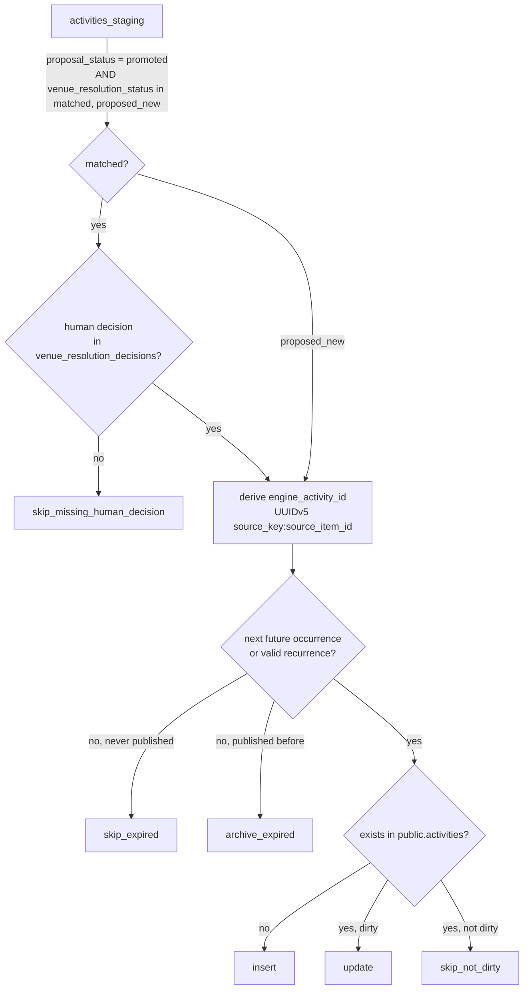

# 04 — Engine Pipeline (AS-IS)

```
collection → raw input → normalization → validation → deduplication → staging → review → publishing
```

> The requested stage names do not map 1:1 onto the code. In particular there is **no single
> "normalization" or "validation" module**: normalization is split between collectors (mechanical)
> and stages (interpretive); validation is distributed across DB constraints, parsers, ER and the
> publishing transformer. `docs/architecture/current/04-pipeline.md` explicitly records that
> "Category Classification", "Business Rules" and "Confidence Score" **never existed as code**.

Global characteristics:

- **Trigger:** manual CLI only (`npx tsx …`). No scheduler, queue or webhook (ADR-0014).
- **Transactions:** none spanning a run. Safety relies on idempotent upserts
  (`ON CONFLICT DO NOTHING`) — `IngestionOrchestrator.ts` header.
- **Logging:** `pino` JSON to stdout (`src/lib/logger.ts`, level from `LOG_LEVEL`, default `info`).
  ER uses its own `ERLogger` (`src/entity-resolution/utils/logging.ts`). CLIs also `console.log`
  human-readable summaries. No log shipping, metrics backend or alerting exists in the repo.
- **Audit records:** `staging.ingestion_runs`, `staging.venue_resolution_runs`,
  `public.publication_runs`, `public.publication_events`.

---

## Stage 1 — Collection

| Aspect | Venues | Activities |
|---|---|---|
| Code | `src/collectors/google-places/GooglePlacesCollector.ts`, `GooglePlacesApiClient.ts`; CLI `scripts/ingest-google-places.ts` (`--region=`, `--limit=`), `scripts/ingest-targeted-venues.ts` | `src/collectors/wordpress-content/WordPressContentCollector.ts`, `WordPressApiClient.ts`; CLI `scripts/ingest-wordpress-content.ts --instance=<key> [--since-days=N] [--dry-run]` |
| Input | Product config: regions (`display_label`, `lat`, `lng`, `radius_m`), category queries | Instance config: `base_url`, `category_id`, `since_days`, `max_pages`, `per_page`, `structured_block_marker`, `region_metadata` |
| Output | `{ items: RawVenueItem[], errors[] }` | `{ items: RawActivityItem[], errors[] }` (via `mapToRawActivityItems`) |
| Validations | Dedupe by `place_id` within a run; drops `CLOSED_PERMANENTLY` and places missing id/name/location (`mapToCanonical`); budget check before each call | Fetch restricted to the configured WordPress `category_id`; a relevance classifier is **not connected** (`posts_rejected_by_relevance` is hard-coded `0`); structured block parser first, narrative fallback only if no structured result; ambiguous posts produce **no item** (go to `errors[]`) — ADR-0003 |
| Error handling | Per-query errors collected; `withRetry` available in `lib/retry.ts` | Per-post errors collected into `errors[]` |
| Observability | `stats.queries_executed`, `estimated_cost_usd`, logs | `stats.posts_fetched`, `posts_parsed_structured_block`, `posts_parsed_narrative_fallback`, … |
| Side effects | **Paid API calls** (Google Places). Budget guard is **in-memory per process** (`InMemoryBudgetRepo`) — it does not remember spend across runs. | HTTP GETs to public municipal sites |

`dry-run-*.ts` scripts run collection without writing to the DB; the Google Places dry run writes a
local JSON cache to `dry-run-snapshots/` (explicitly "not source of truth", ADR-0022).

## Stage 2 — Raw input (Layer A)

| Aspect | Detail |
|---|---|
| Code | `IngestionOrchestrator.runVenueIngestion / runActivityIngestion`; `RawVenueItemRepository.insertBatch`, `RawActivityItemRepository.insertBatch` |
| Input | Collector items (activities: after stage 02 in memory) |
| Output | Rows in `staging.raw_venue_items` / `staging.raw_activity_items`; returns only effectively inserted `{id, source_item_id}` |
| Validations | DB NOT NULL / CHECK / FK constraints (e.g. `source_key` must exist in `public.sources`); `UNIQUE(source_key, source_item_id, ingestion_run_id)` |
| Error handling | Batch of 50 via `upsert(..., ignoreDuplicates: true)`; any DB error throws → orchestrator marks the run `failed` and rethrows |
| Observability | `IngestionRun` opened (`running`) before collection; log `raw_*_items inseridos {attempted, persisted}` |
| Side effects | Permanent rows (append-only by RLS; see `03` for the `service_role` caveat) |

Reprocessing: `scripts/reprocess-venues-from-raw.ts --region=<key>` replays venues from Layer A
through the **same** staging logic (`stageVenues`) with zero API cost. No equivalent exists for activities.

## Stage 3 — Normalization

There is no dedicated module. What exists:

| Kind | Where | Notes |
|---|---|---|
| Mechanical (trim, encoding, HTML→text) | Collectors and their `parsers/sharedTextUtils.ts` | ADR-0001 |
| Date/time extraction to `RawOccurrence` (`YYYY-MM-DD`, `HH:MM`) | `structuredBlockParser.ts`, `narrativeFallbackParser.ts`, `servicoBlockParser.ts` | PT-BR vocabulary ("Dia:", "Data:", "Horário:", "Local:") is fixed in the engine |
| Venue mention extraction | Same parsers → `VenueMention` with `confidence_hint` | Never geocoded |
| Recurrence | `src/pipeline/stages/02-recurrence-detection/detectRecurrence.ts` | Pure; produces `weekly` or `null`; may populate `recurrence_text_hint` on a **new** item object before raw persistence |
| Venue city | `VenueStagingRepository` copies `source_region_label` → `venues_staging.city` | |
| Timezone | **Not resolved.** `occurrenceSelection.ts` combines date+time "como UTC puro"; comment acknowledges up to 3h drift for `America/Sao_Paulo`. `region_metadata.timezone` exists in config but is not consumed. |

Recurrence `review_reasons` (`recurrence_end_time_not_persisted`, `recurrence_per_day_times_not_representable`,
`recurrence_ordinal_month_not_representable`) are returned by stage 02 but **not persisted** by
`ActivityStagingRepository` (observed).

## Stage 4 — Validation

Distributed:

| Check | Where | Effect |
|---|---|---|
| Venue admission by type/keyword | `00-filter-venue` (`decideVenueFilter`, `defaultRules.ts`, `products/vivere-60-mais.ts`) | `rejected` → not staged; `accepted` / `needs_review` / ambiguity label → staged as `pending_review` (decision itself not persisted) |
| Venue regional distance | `01-geographic-gate` (`BUFFER_METERS = 500`) | `buffer_zone` + `accepted` downgraded to `needs_review`; `geographic_status` persisted; `outside_region` blocked at publishing |
| Activity parse ambiguity | Collectors' parsers | No item, or item with `raw_payload.review_reasons` |
| Schema validation | Postgres CHECK/FK/NOT NULL | Throws → run `failed` |
| Occurrence shape | `PublishableActivityRepository.parseOccurrences` | Throws per row; row **excluded from the publishing run** and logged (not counted in `errors`) |
| Recurrence validity | `PublicationTransformer.isValidStructuredRecurrence` | Invalid rule → treated as no recurrence |
| Human validation | Review API state machine | Mandatory for publication |

There is **no** runtime schema validator (e.g. zod) on collector output; contracts are TypeScript types only.

## Stage 5 — Deduplication

| Level | Mechanism | Code |
|---|---|---|
| Within a Google Places run | `place_id` dedupe | `GooglePlacesCollector` |
| Raw (per run) | `UNIQUE(source_key, source_item_id, ingestion_run_id)` | 0001 |
| Venues staging (cross-run) | `UNIQUE(source_key, source_item_id, product_key)` | 0004, `VenueStagingRepository` |
| Activities staging | `UNIQUE(raw_activity_item_id)` only — **re-collection creates a new staging row** | 0003, `ActivityStagingRepository` |
| Activities published (cross-run) | `engine_activity_id = UUIDv5(source_key:source_item_id)` reconciles insert vs update | `activityIdentity.ts`, `ActivityPublisher.buildDecision` |
| Venue ↔ activity linking | Entity Resolution (weights name 0.50 / geo 0.35 / address 0.15; exactly one candidate ≥ 0.85 → `matched`; two or more ≥ 0.85 → `ambiguous`; best ≥ 0.50 → `unresolved`; none ≥ 0.50 or empty pool → `proposed_new`) | `src/entity-resolution/config/index.ts`, `ThresholdClassifier.ts` |
| Duplicate venue report | `detectVenueDuplicates` (informational in `--preview`) | `src/publishing/services/duplicateDetection.ts` |
| Cross-source dedupe by priority | **Not implemented** (`sourcePriority.ts` header) | — |

## Stage 6 — Staging (Layer B)

| Aspect | Venues | Activities |
|---|---|---|
| Code | `IngestionOrchestrator.stageVenues` → `VenueStagingRepository.insertBatch` | `ActivityStagingRepository.insertBatch` |
| Initial state | `proposal_status='pending_review'`, `geographic_status` from gate, `city`, `name` | `proposal_status='pending_review'`, `venue_resolution_status='unresolved'`, `recurrence_*` |
| Error handling | Missing raw id (conflict) → warn and skip row; DB error → throw | same |
| Observability | `IngestionSummary { stagedItems, rejectedItems, geoExcludedItems }` logged | `IngestionSummary` |

Then Entity Resolution (activities only):

| Aspect | Detail |
|---|---|
| Code | `src/entity-resolution/run.ts --product-key=… | --activity-id=…` → `EntityResolutionEngine.resolveAll/resolve` |
| Input | `activities_staging` with `venue_resolution_status IN ('unresolved','ambiguous')`; candidate pool = `venues_staging` with `proposal_status IN ('approved','promoted')` |
| Output | `venue_resolution_runs`, `venue_resolution_candidates`, updated `venue_resolution_status`, `resolved_venue_staging_id`, `resolution_confidence` |
| Rules | Activities **without** a venue mention return `unresolved` with reason `no_venue_mention` (they stay unresolved and are therefore not publishable until a human acts). Activities whose candidate pool is **empty after the pre-filter** are automatically set to `proposed_new` (`EntityResolutionEngine.runPipeline`) — and `proposed_new` does not require a human ER decision to publish. Human decisions are protected (ADR-0013). Orphan `running` runs are marked failed on next `resolveAll`. |
| Note | `run.ts --dry-run` only checks env vars; it does not simulate resolution. |

## Stage 7 — Review

See `05-REVIEW-API-AND-ADMIN.md`. Summary: `pending_review → approved → promoted` (promote = admin);
ER decisions `accept` / `override` (reviewer, admin), `propose-new` (admin). CLI equivalents:
`src/review-api/run-review-action.ts`, `src/entity-resolution/run-human-resolution.ts`.

## Stage 8 — Publishing

| Aspect | Detail |
|---|---|
| Code | `src/publishing/publish.ts --product-key=… [--dry-run | --preview]` → `PublishingEngine`, `VenuePublisher`, `ActivityPublisher`, `PublicationTransformer` |
| Input | Promoted staging rows of one product (one run = one product, ADR-0017) |
| Output | Insert/update/archive in `public.venues` / `public.activities`; `publication_runs`; `publication_events`; `promoted_*_id` back-link in staging |
| Activity decisions | `insert`, `update`, `skip_not_dirty`, `skip_expired`, `archive_expired`, `skip_missing_human_decision`, `error` |
| Validations | Promotion gate; human decision required for `matched` (enforced only when `ActivityPublisher` receives the optional `decisionRepo`; `publish.ts` injects it in both `--preview` and real mode — other callers would skip this check); next future occurrence ≥ `asOf` (injected); valid recurrence allows `start_date = NULL`; whitelist of writable fields (ADR-0018) |
| Error handling | Per-item errors counted; run `partial` if errors > 0, `failed` on exception. `PublicationRunRepository.findActive()` exists but is **not called** by `PublishingEngine` (observed) — there is no concurrency guard against two simultaneous publish runs. |
| Observability | `--preview` prints counts and samples per bucket, flags `⚠ ANÓMALO`; run metrics in `publication_runs` |
| Side effects | Writes the public dataset consumed by the mobile app. **Known gap:** published activities are only re-evaluated for expiry when they become "dirty" again; no periodic expiry job (ADR-0020). |


