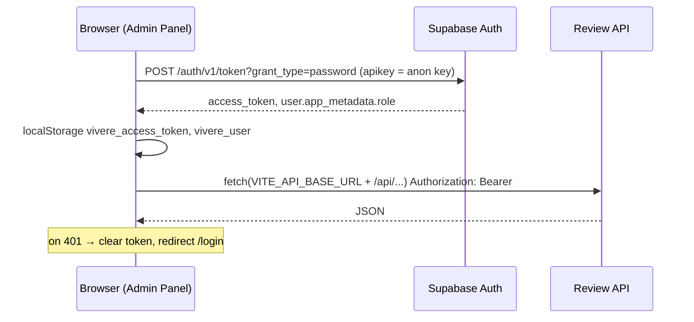

# 05 — Review API and Admin Panel (AS-IS)

No secret values appear in this document. Environment variables are referenced by name only.

---

## 1. Review API

| Item | Value | Source |
|---|---|---|
| Framework | Hono 4 (`hono`, `@hono/node-server`) | `package.json`, `src/review-api/server.ts` |
| Entry point | `src/review-api/server.ts` (top-level `await`, ESM) | |
| Start command | `npx tsx --env-file=.env src/review-api/server.ts` (no npm script exists) | ADR-0009 |
| Port | `REVIEW_API_PORT`, default `3001` | `server.ts` |
| DB access | Supabase client with `SUPABASE_SERVICE_KEY` (`service_role`, bypasses RLS) | `src/persistence/client/supabase.ts` |
| Middleware order | `cors` → `hono/logger` → `authMiddleware` on `/api/*` | `server.ts` |

### 1.1 Endpoints

All `/api/*` routes require `Authorization: Bearer <Supabase access token>`.

| Method | Path | Role required (enforced in service layer) | Purpose |
|---|---|---|---|
| GET | `/health` | none | `{status, service, version, env}` |
| GET | `/api/venues` | any authenticated (defaults to `viewer`) | List `venues_staging` (+ raw JOIN). Query: `page`, `pageSize`, `search`, `status`, `product_key`, `city`, `category`, `source`, `geographic_status`, `sort`, `order` |
| GET | `/api/venues/:id` | any authenticated | Detail incl. `raw_payload` |
| PATCH | `/api/venues/:id/approve` | `reviewer`, `admin` | `pending_review → approved` |
| PATCH | `/api/venues/:id/reject` | `reviewer`, `admin` | `pending_review|approved → rejected` |
| PATCH | `/api/venues/:id/promote` | `admin` | `approved → promoted` (staging only) |
| GET | `/api/activities` | any authenticated | List `activities_staging`. Query: `page`, `pageSize`, `search`, `status`, `product_key`, `venue_resolution`, `source`, `sort`, `order` |
| GET | `/api/activities/:id` | any authenticated | Detail incl. `raw_payload`, `occurrences` |
| PATCH | `/api/activities/:id/approve` \| `reject` \| `promote` | as for venues | same state machine |
| GET | `/api/ingestion-runs?limit=` | any authenticated | Latest runs (default 20) |
| GET | `/api/stats?product_key=` | any authenticated | `PlatformStats`; `product_key` **required** (400 otherwise) |
| GET | `/api/entity-resolution/health?product_key=` | any authenticated | 503 when health is `critical` |
| GET | `/api/entity-resolution/queue?product_key=&status=&page=&pageSize=` | any authenticated | ER review queue |
| GET | `/api/entity-resolution/stats?product_key=` | any authenticated | ER stats |
| GET | `/api/entity-resolution/:activityId/candidates` | any authenticated | Candidates for an activity |
| PATCH | `/api/entity-resolution/:activityId/accept` body `{candidateId, notes?}` | `reviewer`, `admin` | Records `matched` decision |
| PATCH | `/api/entity-resolution/:activityId/override` body `{candidateId, notes}` (notes required) | `reviewer`, `admin` | Same as accept, flags `overrode_high_confidence` when appropriate |
| PATCH | `/api/entity-resolution/:activityId/propose-new` body `{notes?}` | `admin` | Records `proposed_new` decision |

There is **no endpoint to create, edit or delete** staging rows, and **no endpoint that writes to
`public.*`**. There is no "re-resolve" endpoint (ADR-0013 mentions one for the Admin Panel; not implemented —
`assertNoPriorDecision` tells the user "o Admin deve limpar a decisão anterior primeiro").

### 1.2 Authentication

`src/review-api/middleware/auth.ts`:

1. Reads `Authorization: Bearer`.
2. Fetches `${SUPABASE_URL}/auth/v1/.well-known/jwks.json` once per process and caches **the first key**
   (`jwks.keys[0]`), imported as ECDSA P-256.
3. Verifies the ES256 signature with Web Crypto and checks `exp`.
4. Role = `payload.app_metadata.role`, **defaulting to `viewer`** when absent.

Not checked: `aud`, `iss`, `alg`/`kid` header, `nbf`. Key rotation requires a process restart.

> Docs drift: ADR-0009 describes HS256 verification with the Supabase JWT secret. The code uses
> ES256 via JWKS. `SUPABASE_JWT_SECRET` is present in the local `.env` but **is not referenced by any
> code** (grep) and is not in `.env.example`.

### 1.3 Authorization

- `ACTION_ROLES` (`src/review-api/types/reviewTypes.ts`): approve/reject → `reviewer`, `admin`; promote → `admin`.
- `ER_ACTION_ROLES` (`EntityResolutionService.ts`): accept/override → `reviewer`, `admin`; proposeNew → `admin`.
- `requireRole()` exists in `auth.ts` but is **not used** by any route; role checks are in services.
- Read endpoints have **no role check**: any valid Supabase user token gets `viewer` access to staging,
  raw payloads, ingestion runs and stats. See `09-SECURITY-AND-ACCESS.md` (finding SEC-A).

### 1.4 Review states and transitions

`ALLOWED_TRANSITIONS`:

```
pending_review: approve → approved, reject → rejected
approved:       promote → promoted, reject → rejected
rejected:       (terminal)
promoted:       (terminal)
```

Behavioural details (observed):

- `updateStatus` throws a plain `Error` on invalid transitions → the route returns **500**, not 409/422.
- `markPromoted` updates `WHERE proposal_status = 'approved'`; if the row is in another state, **0 rows
  change and the API still returns `{success: true}`**.
- ER `recordAccept` / `recordProposeNew` perform several sequential writes (decision → candidates →
  activity) **without a transaction and without checking errors** of the later steps.
- `reviewed_by` stores the Supabase user id (`sub`).

### 1.5 Error responses

`401` missing/invalid token; `403` role; `404` not found; `400` missing `product_key` or required body
field; `500` generic (`"Erro interno do servidor"`, details only in logs).

### 1.6 CLI equivalents (bypass HTTP auth, use service key)

- `src/review-api/run-review-action.ts --activity-id --action --user-id --user-email --user-role`
  — the caller **asserts its own role** on the command line.
- `src/entity-resolution/run-human-resolution.ts --activity-id --candidate-venue-id --user-id [--notes]`.

---

## 2. Admin Panel

| Item | Value |
|---|---|
| Stack | React 18, Vite 5, TypeScript, TanStack Query 5, React Router 6, Tailwind 3, Radix UI, lucide-react |
| Scripts | `npm run dev` (Vite, port 5173), `npm run build` (`tsc -b && vite build`), `npm run preview` |
| Env vars | `VITE_API_BASE_URL`, `VITE_SUPABASE_URL`, `VITE_SUPABASE_ANON_KEY` (`src/config.ts`) |
| Routes | `/login`, `/dashboard`, `/venues`, `/venues/:id`, `/activities`, `/activities/:id`, `/ingestion-runs`, `/entity-resolution`, `/settings` (placeholder) |
| Product selector | Hard-coded `PRODUCTS = [{ key: 'vivere-60-mais' }]` in `components/layout/AppShell.tsx` |

### 2.1 Frontend ↔ backend communication



- No Supabase JS client in the panel; raw `fetch` (`src/auth/authClient.ts`, `src/api/client.ts`).
- No refresh-token handling: when the access token expires the user is sent back to login.
- `ProtectedRoute` checks only that a user object exists in `localStorage`. Role-based UI hiding
  (e.g. `canReview`, `isAdmin` in `EntityResolutionPage.tsx`) is cosmetic — the API enforces roles.
- Services: `ActivityService`, `VenueService`, `EntityResolutionService`, `StatsService` mirror the endpoints above.
- Promote actions require a confirm dialog (`useReviewMutation` → `ConfirmDialog`).

### 2.2 Operations available in the UI

| Area | Operations |
|---|---|
| Dashboard | Stats per product (venues/activities by status, ingestion, estimated Google budget) |
| Venues | List/filter (status, city, category, geographic_status; the API also accepts `source`), detail with query info and geographic gate section, approve/reject/promote. The persisted filter decision (accepted vs needs_review) is not shown because it is not stored (see `03` §9) |
| Activities | List/filter (status, venue_resolution), detail incl. occurrences and raw payload, approve/reject/promote |
| Entity Resolution | Queue, candidates per activity, accept / override / propose-new |
| Ingestion runs | Read-only list |

Not available in the UI: triggering ingestion, ER runs or publishing (all CLI); editing record content;
archiving published records; user/role management (roles are set in Supabase `app_metadata`, procedure
**To be confirmed**).

### 2.3 Security notes

- Access token stored in `localStorage` (XSS-exposed by design choice).
- The anon key in the panel bundle is public by design; the panel itself never uses it beyond Auth.
- Both `admin-panel/.env.development` and `admin-panel/.env.production` are **tracked in git**
  (they predate the `**/.env.*` ignore rule). They contain a Supabase URL, an API URL and a key: in the
  development file it is a JWT with `role=anon`; in the production file the value is not a JWT and its
  type could not be identified (placeholder or new-format publishable key — **To be confirmed**).
  Both files point at the **production** Supabase project (project ref compared with the one named
  as production in `docs/runbooks/staging-bootstrap.md`). See `09-SECURITY-AND-ACCESS.md`.
- Production hosting/URL of the panel and API: **Unknown / To be confirmed**
  (`server.ts` logs a sample `CORS_ORIGIN` domain in an error message; whether it is real is not confirmed).
