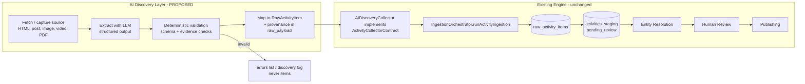

# 06 — AI Discovery Integration Contract

> **Read this first if you are building the AI Discovery Layer.**
>
> Part A documents the contract that **already exists** in the Engine and can be inferred from code.
> Part B is a **PROPOSED** design for how a future AI Discovery Layer should plug into it.
> **Nothing in Part B exists in the repository.** Do not describe Part B as implemented in PRs,
> ADRs or status reports.

## Mandatory principle

> **The AI Discovery Layer must NEVER bypass the existing validation / review / publishing pipeline,
> and must NEVER publish directly into the public dataset (`public.venues`, `public.activities`,
> or any other `public.*` table).**

This is consistent with, and enforced in code by, existing decisions:

- ADR-0019 Invariant 1 — only the Publishing Engine writes engine data into `public.venues/activities`.
- ADR-0023 — "Activity Discovery produz PROPOSTAS. Discovery output NÃO é autorização de publicação."
  Automatic approval/promotion "contradiria directamente o invariante 'Promotion nunca é automática'".
- `PublishableActivityRepository` — only `proposal_status = 'promoted'` rows are publishable.

---

# Part A — Contract inferable from the current Engine (AS-IS)

## A.1 The integration seam that already exists

The Engine ingests activities through one generic interface
(`src/persistence/types/collectorContracts.ts`):

```ts
export interface ActivityCollectorContract<TOptions = Record<string, unknown>> {
  readonly sourceKey: string;
  collect(options?: TOptions): Promise<{
    items: RawActivityItem[];
    errors: Array<{ message: string; source_item_id: string | null }>;
  }>;
}

export interface SourceConfigContract {
  readonly source_key: string;
  readonly product_key: string;
  readonly regions?: readonly { display_label: string; lat: number; lng: number; radius_m: number }[];
}
```

and one orchestrator entry point:

```ts
new IngestionOrchestrator(await RepositoryFactory.forSupabase())
  .runActivityIngestion(collector, sourceConfig, { dryRun?, sinceDays? });
```

`IngestionOrchestrator` never imports concrete collectors (ADR-0007). **Any new producer of
activities that implements `ActivityCollectorContract` gets the full existing pipeline for free:**
IngestionRun audit → recurrence detection → raw append-only persistence → staging as
`pending_review` / `unresolved` → Entity Resolution → Human Review → Publishing gate.

`collect()` receives `{ sinceDays }` from the orchestrator; other options are not forwarded.

## A.2 The candidate payload that already exists: `RawActivityItem`

From `src/types/RawActivityItem.ts` and table `staging.raw_activity_items`:

| Field | Required | Type / constraint | Engine behaviour |
|---|---|---|---|
| `source_key` | yes | must exist in `public.sources` (FK) | FK violation → run `failed` |
| `source_item_id` | yes | text, "único e estável dentro da fonte" | **Drives public identity**: `engine_activity_id = UUIDv5(source_key + ':' + source_item_id)` |
| `collected_at` | yes | ISO 8601 | Used by Publishing as the "updated at" signal for dirty checks |
| `title` | yes | non-null text | Shown to reviewers; published to `public.activities.title` |
| `description` | no (`null`) | text | Published; used by recurrence detection |
| `raw_category_text` | no | text — never a `categories.key` | Not published |
| `occurrences` | yes (may be `[]`) | array of `{date:'YYYY-MM-DD', time:'HH:MM'|null, end_date|null, end_time|null}` | Next future occurrence → `start_date`/`end_date`. Any entry without a string `date` makes the row **unpublishable** (`parseOccurrences` throws; row excluded + logged) |
| `recurrence_text_hint` | no | free text | May be **overwritten** by stage 02 when it detects recurrence |
| `venue_mention` | no | `{raw_text, raw_address_text|null, confidence_hint}` | Input to Entity Resolution; `null` → activity stays `unresolved` (`no_venue_mention`) |
| `venue_mention.confidence_hint` | if mention | `'explicit_name' | 'inferred_from_context' | 'ambiguous'` (CHECK) | Adds +0.10 / 0 / −0.10 to ER score |
| `price_text`, `is_free_hint` | no | text / boolean | Not published (ADR-0018 preserved fields) |
| `image_url`, `external_url`, `contact_phone`, `contact_email` | no | text | `image_url → imagem_url`, `external_url → url`, `contact_phone → phone` |
| `language` | no | `'pt' | 'en' | null` (CHECK) | Any other value → DB error, run `failed` |
| `raw_payload` | yes | JSON object | Stored verbatim. Keys `extraction_method`, `raw_text`, `article_context_text` are **read by recurrence detection** |

Contract rules stated in the code: optional fields are explicit `null`, never omitted; "Nenhuma
interpretação de negócio acontece aqui"; an activity source has **no epistemic authority** to state
venue coordinates/phone/website (ADR-0002) — only a textual `venue_mention`.

## A.3 What the Engine does after hand-off (responsibilities already owned by the Engine)

| Responsibility | Owner today | Code |
|---|---|---|
| Run audit (`ingestion_runs`) | Engine | `IngestionOrchestrator`, `IngestionRunRepository` |
| Structured recurrence (`recurrence_type/days/time`) | Engine (stage 02, deterministic, PT-BR vocabulary, `weekly` only) | `detectRecurrence.ts` |
| Raw evidence persistence | Engine | `RawActivityItemRepository` |
| Staging state (`pending_review`, `unresolved`) | Engine | `ActivityStagingRepository` |
| Venue resolution | Engine ER + humans | `src/entity-resolution/` |
| Content approval / promotion | Humans via Review API | `ReviewService` |
| Next-occurrence selection, expiry, recurrence validity | Engine Publishing | `PublicationTransformer`, `occurrenceSelection.ts` |
| Public identity and cross-run reconciliation | Engine Publishing | `activityIdentity.ts`, `ActivityPublisher` |
| Field whitelist into `public.activities` | Engine Publishing | ADR-0018 |

## A.4 Gaps in the AS-IS contract that matter for AI-sourced data

| # | Gap (observed) | Consequence for AI Discovery |
|---|---|---|
| G1 | No runtime schema validation of `RawActivityItem` (TypeScript types only) | Malformed candidates fail late (DB error kills the **whole run**) or silently become unpublishable |
| G2 | Activities have no staging-level cross-run dedup (`UNIQUE(raw_activity_item_id)` only) | Each re-discovery creates a new `pending_review` row → review load |
| G3 | No cross-source dedup (`sourcePriority.ts` "ainda NÃO implementado") | Same event found by WordPress collector and by AI → two public activities |
| G4 | `ingestion_runs` stores only counts; `markFailed` does not store the reason | No place for model/prompt/cost metrics |
| G5 | Recurrence `review_reasons` and venue filter decisions are not persisted | Reviewer cannot see machine uncertainty except via `raw_payload` |
| G6 | Times are treated as UTC (`occurrenceSelection.ts`) | Local-time events can shift up to 3h in comparisons |
| G7 | Budget guard is per-process memory | No persistent spend cap for paid APIs |
| G8 | `public.sources` / `public.products` rows are not seeded by code | A new `source_key` must be inserted manually before the first run |
| G9 | Review UI shows `raw_payload` as a raw accordion only | AI provenance/confidence will not be surfaced nicely without UI work |

---

# Part B — PROPOSED integration of the AI Discovery Layer

> Everything below is **PROPOSED**. It requires an ADR (suggested **ADR-0025 — AI Discovery Layer
> boundary**) before implementation, because ADR-0023 classifies schema expansion and anything that
> weakens Human Review containment as requiring explicit architectural review.

## B.1 Boundary



**Proposed rule set:**

1. The AI Discovery Layer's **only output to the Engine** is `RawActivityItem[]` + `errors[]`, delivered
   through an `ActivityCollectorContract` implementation (e.g. `AiDiscoveryCollector`), invoked by
   `IngestionOrchestrator.runActivityIngestion`.
2. The AI Discovery Layer has **no database write path of its own** (no direct PostgREST/SQL access
   to any `staging.*` or `public.*` table). Persistence stays inside the existing repositories. Note:
   the `AiDiscoveryCollector` adapter runs inside the Engine CLI process, which holds the service key;
   the LLM/fetch components should be designed so they never need it (e.g. a separate module or
   process that returns candidates, with the adapter as the only Engine-facing piece).
3. It never sets `proposal_status`, `venue_resolution_status`, `recurrence_*`, `engine_status`,
   `promoted_*`, or any review field — those columns are not part of `RawActivityItem` anyway.
4. It never produces `RawVenueItem` (it has no authority over places, ADR-0002) — venues are expressed
   only as `venue_mention`.
5. It never calls the Review API or Publishing CLI.

## B.2 Candidate event (PROPOSED shape)

The candidate **is** a `RawActivityItem` (no new Engine contract), with AI-specific metadata in
`raw_payload.ai_discovery`. Proposed TypeScript (for the AI layer's own code, validated before mapping):

```ts
// PROPOSED — not in the repository
interface AiDiscoveryProvenance {
  schema_version: 'ai-discovery/1';
  source: {
    url: string;                 // canonical URL of the original publication (required)
    url_canonicalization: string;// e.g. 'strip-utm,lowercase-host'
    channel: 'website' | 'social_post' | 'image' | 'video' | 'pdf';
    publisher_name: string | null;
    published_at: string | null; // ISO, as stated by the source; null if unknown
    fetched_at: string;          // ISO
    content_sha256: string;      // hash of the exact bytes/text sent to the model
    snapshot_ref: string | null; // pointer to stored copy (storage location TBD)
  };
  extraction: {
    provider: string;            // e.g. vendor id — provider-agnostic string
    model: string;               // exact model id/version
    prompt_id: string;           // e.g. 'event-extract'
    prompt_version: string;      // semver or git sha
    output_schema_version: string;
    temperature: number | null;
    run_id: string;              // AI layer's own run id
    attempt: number;
    input_tokens: number | null;
    output_tokens: number | null;
    estimated_cost_usd: number | null;
    started_at: string;
    finished_at: string;
  };
  evidence: Array<{              // every extracted field must point to a quote
    field: 'title' | 'date' | 'time' | 'end_date' | 'end_time' | 'venue' | 'address' | 'price' | 'recurrence' | 'audience';
    quote: string;               // verbatim substring of the source text / OCR / transcript
    locator: string | null;      // e.g. char offsets, page number, timestamp in video
  }>;
  confidence: {
    overall: number;             // 0..1, computed deterministically (see 07), NOT self-reported only
    per_field: Record<string, number>;
    model_self_reported: number | null;
  };
  relevance_60_plus: { label: 'explicit' | 'plausible' | 'unknown'; quote: string | null };
  review_reasons: string[];      // e.g. 'date_inferred_from_weekday', 'multiple_events_in_source'
  possible_duplicates: Array<{ url: string; reason: string }>; // hints only, never auto-merge
}
```

Mapping to `RawActivityItem` (PROPOSED):

| RawActivityItem field | From | Rule |
|---|---|---|
| `source_key` | AI source config | Must already exist in `public.sources` (G8). Naming convention **To be decided** (see B.12 Q1) |
| `source_item_id` | Deterministic | See B.5 |
| `collected_at` | `source.fetched_at` | |
| `title` | extracted title | Must have evidence quote |
| `description` | verbatim relevant excerpt (not an LLM summary) | Keeps recurrence detection operating on source text |
| `occurrences` | extracted concrete dates only | Only dates **explicitly present** in source; never computed "next Friday" |
| `recurrence_text_hint` | verbatim quote of recurrence phrase or `null` | Never a structured rule |
| `venue_mention` | extracted venue text | `confidence_hint`: `explicit_name` only if quote is an explicit "Local:"-style statement; otherwise `inferred_from_context` / `ambiguous` |
| `price_text`, `is_free_hint` | verbatim | `is_free_hint` only if explicitly stated |
| `image_url` | only if the source provides a public image URL | |
| `external_url` | `source.url` | **Required** for AI candidates (proposal) |
| `language` | detected language | Only `'pt'`, `'en'` or `null` (DB CHECK) |
| `raw_payload` | `{ extraction_method: 'ai_discovery', raw_text: <source text/OCR/transcript>, ai_discovery: AiDiscoveryProvenance }` | `raw_text` is only read by stage 02 when `extraction_method === 'narrative_fallback'` — whether AI items should reuse that value to enable recurrence detection is an **open decision** (B.12 Q4) |

## B.3 Required vs optional information (PROPOSED)

A candidate is **emitted as an item** only if all of these hold; otherwise it goes to `errors[]`:

- `title` with evidence quote;
- `source.url` and `content_sha256`;
- at least one of: a concrete `occurrences[]` entry with explicit date evidence, **or** a recurrence
  phrase with a weekday (so stage 02 can attempt detection);
- `language ∈ {pt, en}`;
- all `occurrences[].date` match `YYYY-MM-DD` and are real calendar dates;
- extraction metadata complete (provider, model, prompt_version, schema version).

Optional: description, venue mention, address, price, image, contact.

## B.4 Provenance and source URL (PROPOSED)

- Every item must be traceable to **one** original publication (`external_url` + `raw_payload.ai_discovery.source.url`).
- The exact text sent to the model (or OCR/transcript) is stored in `raw_payload.raw_text` and hashed.
- A durable snapshot of the original content (HTML/image/PDF/video frames) is **recommended**; storage
  location (Supabase Storage bucket vs other) is **To be decided** (B.12 Q6). Note that `raw_payload`
  is append-only and should not hold large binaries.
- Aggregator/repost content must reference the original publisher URL where determinable; otherwise
  `review_reasons += 'secondary_source'`.

## B.5 Idempotency (PROPOSED)

Because public identity is `UUIDv5(source_key:source_item_id)`, `source_item_id` **must be stable across
re-runs and model versions**:

- Proposed: `source_item_id = <sha256(canonical_url)[0..16]>_<event_index>` where `event_index` is the
  0-based order of events as they appear in the source **after deterministic sorting by
  (first evidence offset)**.
- Do **not** include model output (e.g. title text) in the id — a re-extraction with a new prompt that
  slightly changes the title would create a new public activity.
- Known limitation: if a later model splits one post into a different number of events, indexes shift
  → identity changes. Mitigation must be decided in the ADR (B.12 Q3).
- Same URL re-fetched with unchanged `content_sha256` → the AI layer should **skip re-extraction**
  (cost). Not re-emitting unchanged items would also avoid another staging row (gap G2), but that is
  an **interim workaround for an Engine gap**: staging-level dedup of activities belongs to the Engine
  and should be solved there (ADR required), not re-implemented in the AI layer. Whether to re-emit
  unchanged items is **To be decided**.

## B.6 Duplicate handling (PROPOSED)

| Case | Proposed handling |
|---|---|
| Same URL, same content | Skip (B.5) |
| Same URL, changed content | Emit with same `source_item_id`; Engine creates a new raw + staging row; Publishing reconciles by identity after human promotion |
| Same event, different URL / different source (incl. existing WordPress collector) | AI layer adds `possible_duplicates` hints only. **No automatic merge or suppression.** True cross-source dedup is an Engine capability that does not exist yet (G3) and needs its own ADR |
| Multiple events in one source | One item per event; `review_reasons += 'multiple_events_in_source'` |

## B.7 Malformed / incomplete candidates (PROPOSED)

- Validation happens **inside the AI layer, before mapping** (schema validation + evidence checks, see `07`).
- Invalid or incomplete → `errors[]` entry `{ source_item_id, message }` with a machine-readable reason.
  They are counted in `ingestion_runs.items_errored` and never reach staging.
- Never "repair" a candidate by inventing values (ADR-0003). Missing date ⇒ no occurrence, not a guess.
- One bad candidate must not fail the whole run: the AI layer must guarantee DB-level validity
  (FK `source_key`, `language` CHECK, `confidence_hint` CHECK, non-null `title`/`raw_payload`) before
  handing over, because a single DB error throws and marks the run `failed` (G1).

## B.8 Validation responsibility (PROPOSED split)

| Check | AI Discovery Layer | Engine (existing) | Human |
|---|---|---|---|
| JSON schema of model output | ✅ | | |
| Evidence quote exists verbatim in source | ✅ | | |
| Date format / calendar validity | ✅ | DB + `parseOccurrences` | |
| Relevance to 60+ audience | flags only | | ✅ decides |
| Structured recurrence | ❌ (never) | ✅ stage 02 | ✅ |
| Venue resolution | ❌ (mention only) | ✅ ER | ✅ |
| Duplicate decision | hints only | identity reconciliation | ✅ |
| Approval / promotion | ❌ | gate | ✅ admin |
| Expiry / next occurrence | ❌ | ✅ Publishing | |

## B.9 Failure handling (PROPOSED)

| Failure | Behaviour |
|---|---|
| Source fetch fails | `errors[]`, continue with other sources |
| LLM timeout / 5xx / rate limit | Bounded retry with backoff (reuse pattern of `lib/retry.ts`), then `errors[]` |
| LLM returns invalid JSON / schema mismatch | One repair attempt max (re-ask with validation error), then `errors[]`; never coerce |
| Budget exceeded | Stop calling the model; return what is already validated; log `budget_exceeded` |
| Orchestrator DB error | Existing behaviour: run `failed`, exception propagated — AI layer must not swallow it |
| Partial run | Today `ingestion_runs` cannot express `partial` from code (only `success`/`failed`) — **To be decided** whether to use the existing `partial` CHECK value |

## B.10 Observability (PROPOSED)

- Keep using `ingestion_runs` for the Engine-side audit (one run per AI source invocation).
- Per-item AI metadata lives in `raw_payload.ai_discovery` (queryable via jsonb).
- AI-run-level metrics (tokens, cost, model, prompt version, validation failure counts by reason,
  duration) need a home: either structured `pino` logs only, or a new table (e.g.
  `staging.ai_discovery_runs`) — **a new table requires a migration + ADR** (B.12 Q5).
- Review-load metric: count of AI-sourced `pending_review` rows per run (ADR-0023 item 6 already lists
  review load as unmeasured).

## B.11 Explicitly out of scope for the AI Discovery Layer

- Writing to `public.*` or to `staging.*_staging` / ER tables directly.
- Auto-approve, auto-promote, auto-publish (ADR-0023).
- Producing venues (`RawVenueItem`) or geocoding.
- Replacing or modifying Activity Discovery V1 parsers (frozen, ADR-0023).
- Changing `deriveEngineActivityId` or the publishing whitelist.

## B.12 Open decisions (need a human / ADR)

| # | Question |
|---|---|
| Q1 | `source_key` granularity: one per discovery channel (`ai_web`, `ai_instagram`, …), one per configured source (like WordPress instances), or one per original publisher? Affects `public.sources` seeding, ER territorial context, and identity |
| Q2 | Which `product_key` and territorial context (`region_metadata.city`) AI sources declare — ER's `WordPressSourceTerritorialContextProvider` only knows WordPress sources today |
| Q3 | Identity stability when event splitting changes between model versions |
| Q4 | Should AI items set `raw_payload.extraction_method` so stage 02 reads `raw_text`? (today only `'narrative_fallback'` enables this) |
| Q5 | New table for AI run metrics vs logs only |
| Q6 | Snapshot storage for source evidence (bucket, retention, legal) |
| Q7 | Legal/ToS policy for social media, images, video, PDFs (Unknown / To be confirmed) |
| Q8 | Is a new collector type allowed under ADR-0023 "nova configuração de fonte que siga um contrato já validado", or does it require V2 review? (Recommendation: write ADR-0025) |
| Q9 | Language: sources in languages other than `pt`/`en` (CHECK constraint) |
| Q10 | Should the Review UI surface `raw_payload.ai_discovery` (evidence, confidence) before AI items go live? (Recommended: yes) |
